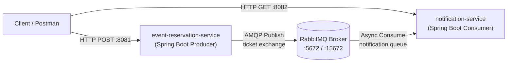
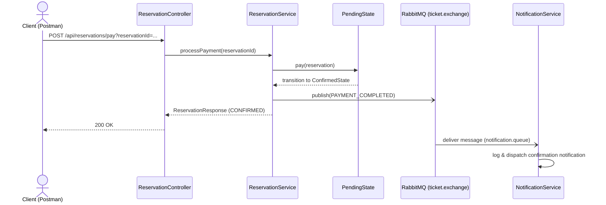

# Event Ticketing Microservices

Java 25 / Spring Boot 3.3 application split into two independently runnable
services and a shared RabbitMQ message-contract module:

- `event-reservation-service` on port 8081 manages events, ticket pricing, and
  in-memory reservations.
- `notification-service` on port 8082 consumes messages and exposes the
  in-memory notification log.
- `ticketing-contracts` contains the JSON event DTO and shared RabbitMQ topology.

The in-memory event, reservation, and notification data is for demonstration
only and is reset when each service restarts.

## System Architecture (Mermaid Diagrams)

### 1. Event-Driven Microservices Deployment & Component Flow


### 2. Payment & Notification Sequence Flow

## Run the full stack

```shell
docker compose up --build
```

RabbitMQ management UI: http://localhost:15672 (local PoC credentials:
`ticketing` / `ticketing`).

## API examples

Create an event:

```http
POST http://localhost:8081/api/events
Content-Type: application/json

{
  "title": "Spring Boot Live",
  "location": "Main Hall",
  "dateTime": "2027-01-15T19:00:00",
  "totalCapacity": 100
}
```

List events using `GET /api/events`, get one using `GET /api/events/{eventId}`,
and inspect pricing types with `GET /api/ticket-categories`.

Create a reservation using an event ID from the response:

```http
POST http://localhost:8081/api/reservations/create
Content-Type: application/json

{
  "userId": "user-123",
  "eventId": "EVENT-UUID",
  "pricingType": "EARLY_BIRD",
  "basePrice": 50.00
}
```

The accepted pricing types are `STANDARD`, `EARLY_BIRD` (20% discount), and
`GROUP_DISCOUNT` (15% discount). Then call
`POST /api/reservations/pay?reservationId=RESERVATION-UUID` or
`POST /api/reservations/expire?reservationId=RESERVATION-UUID`.

Each lifecycle change is published as JSON to the durable topic exchange
`ticket.exchange` with event types `RESERVATION_CREATED`, `PAYMENT_COMPLETED`,
and `RESERVATION_EXPIRED`. Created and paid events are routed to
`notification.queue`; expiry events are routed to `expiration.queue`. The notification service
simulates email/SMS delivery and exposes the resulting records at
`GET http://localhost:8082/api/notifications`.

## Build and test

```shell
mvn clean verify
docker compose build
```

The GitHub Actions workflow runs both commands for pushes and pull requests
targeting `main`.

